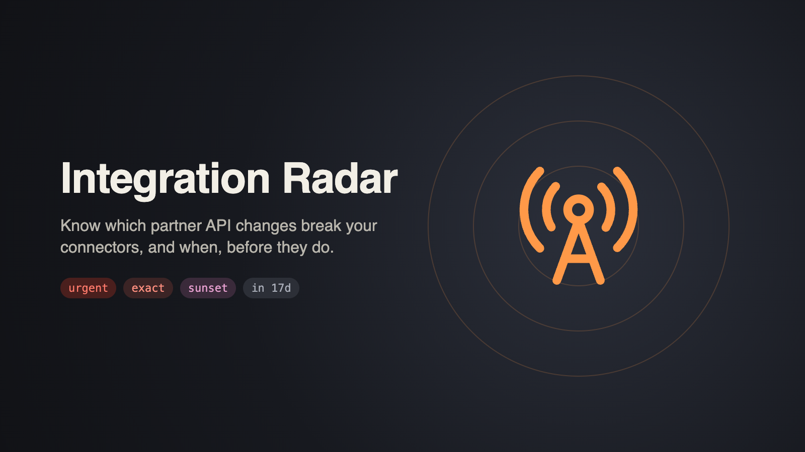
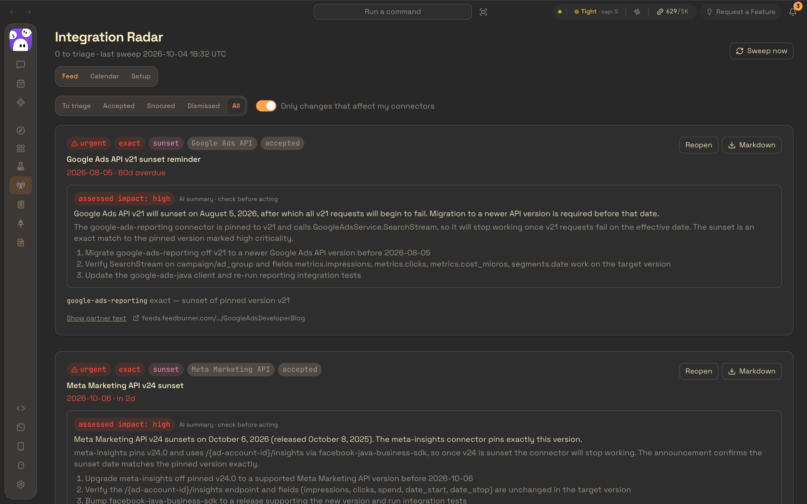
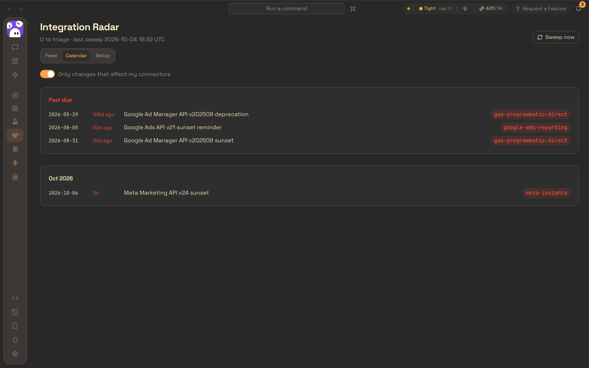
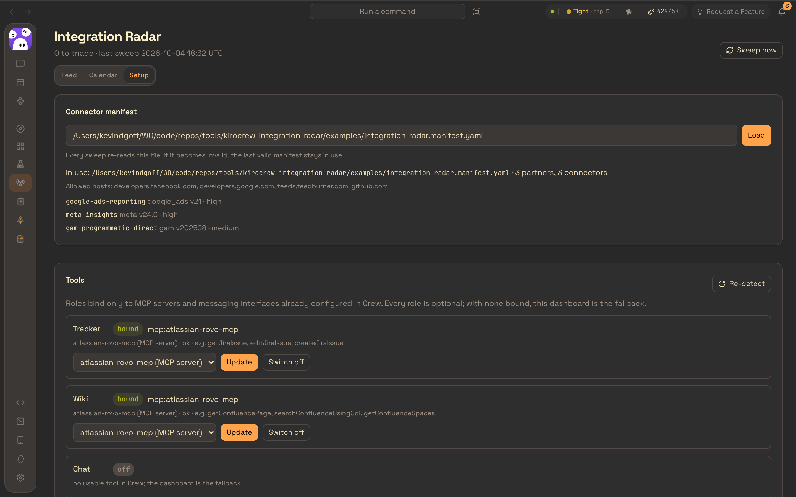

# Integration Radar



A [Kiro Crew](https://kiro.dev/docs/crew/apps/) app that watches partner API changelogs, deprecation notices and
sunset schedules, maps each change to the connectors your product actually uses, and tells you what needs work
and by when.

- **Feed**: partner changes ranked by impact and deadline, each matched to your connectors with a confidence
  (`exact`, `likely` or `possible`) and the reasons behind it. Accept, snooze or dismiss; copy any change as
  Markdown to paste into whatever tracker you use.
- **Calendar**: every deadline that touches your connectors, past-due first.
- **Urgent alerts**: a Crew dashboard notification when a matched change comes within 30 days of taking effect.
- **Weekly digest** (opt-in): a summary posted to the chat you choose, or kept in the dashboard.
- **AI summaries**: a plain-English summary, an impact judgment and next steps for each matched change, clearly
  labelled and kept apart from the deterministic match.

| Feed | Calendar | Setup |
| --- | --- | --- |
|  |  |  |

## How it works

You describe your integrations once, in a **connector manifest** (YAML): which partners you integrate with, where
they publish changes, and for each connector the API version it pins and the services, endpoints and fields it
uses. Everything else is discovered.

Once a day the backend sweeps each partner's sources, normalizes what it finds into change records, merges the
same announcement seen on several sources into one, and matches each change against your connectors. Fetching,
parsing, deduplication and matching are deterministic: no model is involved. Agents are used only to summarize
(`change-analyst`) and to deliver (`radar-courier`).

```
partner pages ──► sweep ──► change records ──► matcher ──► ranked feed ──► alerts / digest
 (allowlisted)    (daily)    (deduplicated)    (your manifest)   │
                                                                 └──► change-analyst (summaries)
```

Integration Radar uses only tools you already have in Crew. It has four optional roles (tracker, wiki, chat and
repo) and binds them only to MCP servers and messaging interfaces already configured there. It never asks for
credentials. With nothing bound, the dashboard does everything.

## Requirements

- Kiro Crew **0.7.2** or later, with a running gateway.
- Node.js 18 or later on the gateway machine. The UI is built on install (`npm install && npm run build`).
- Network access from the gateway to the partner hosts named in your connector manifest, and to nothing else.

The backend runs under the gateway's own Python interpreter, and its only extra dependency is PyYAML, which the
gateway installs from `requirements.txt`.

## Install

From a local checkout:

```bash
kirocrew app install /absolute/path/to/integration-radar
kirocrew app enable integration-radar
```

Crew blocks third-party app code until you trust it. Trust this app alone (not every third-party app) in
**Settings**, or with:

```bash
kirocrew config set agent.apps_trusted '["integration-radar"]'
```

If you already trust other apps, add `integration-radar` to that list instead of replacing it. Then enable the
app again if the first enable was refused. **Integration Radar** appears in the sidebar.

To check it is running:

```bash
kirocrew app info integration-radar
kirocrew doctor
```

## First run

1. **Write a connector manifest.** Copy [`examples/integration-radar.manifest.yaml`](examples/integration-radar.manifest.yaml)
   and replace every `TODO` with your own values. The file holds no secrets.
2. **Load it** in **Setup → Connector manifest** by entering its absolute path. Errors are shown with line numbers.
   If you later break the file, the last valid manifest stays in use.
3. **Sweep now** (top right). After that, the daily sweep runs at the time set in **Setup → Schedule**
   (06:00 UTC by default), and catches up once if the gateway was down.
4. **Triage the Feed.** Dismissing needs a reason, which is saved as a Crew lesson; later changes that look
   like a dismissed one are shown collapsed with that lesson, never hidden.
5. **Optional:** in **Setup → Tools**, confirm a chat interface and pick a destination from its live list, then
   switch on the weekly digest.

## The connector manifest

```yaml
schema_version: 1
product: my-product
partners:
  example_api:
    display_name: Example API
    versioning: major            # major (v21) | dated (v202508) | semver (1.4.0) | rolling
    poll: daily                  # or weekly
    sources:
      - kind: sunset_schedule
        url: https://docs.example.com/api/sunset-dates
connectors:
  - id: example-reporting
    partner: example_api
    lifecycle: active            # active | legacy | retiring
    api:
      version: v21               # the version you pin today
    surfaces:
      - service: ReportService   # or endpoint: /v1/reports
        resources: [report]
        fields: [metrics.clicks, segments.date]
    criticality: high            # high | medium | low
```

The validation rules:

- Unknown keys, duplicate keys and YAML anchors are errors.
- Every connector names a defined partner and has at least one surface.
- `api.version` must fit the partner's `versioning`.
- Source URLs must be HTTPS. Their hosts form the **only** outbound allowlist: redirects to other hosts or to
  plain HTTP are refused.
- Credential-like keys (`token`, `secret`, `password`, `api_key`) are rejected anywhere in the file.
- `legacy` and `retiring` connectors are flagged "migrate or retire" rather than "fix".

The bundled `connector-manifest` skill explains every field in detail.

**Match quality depends on your surfaces.** List the exact field names your connector reads or writes. A change
that names a listed field is an `exact` match, and so is any sunset or deprecation of the version you pin.

## Sources

| Source kind | Status in v0.1 |
| --- | --- |
| `csv_schedule` | Supported. A machine-readable version schedule (version, release, deprecation and sunset dates). |
| `sunset_schedule` | Supported. HTML version tables, including tables rendered client-side as JSON. |
| `feed` | Supported. RSS and Atom; kind and versions come from the entry title. |
| `release_notes`, `changelog`, `out_of_cycle`, `api_spec_repo` | Accepted in the manifest but reported as *unsupported* (not failing) until adapters exist. |

Adapters are pluggable, keyed by source kind and host (`backend/radar/adapters.py`). A source that fails two
sweeps in a row, including a page whose layout changed so nothing parses, marks its partner **stale**. The digest
and the dashboard both say so.

## Alerts and the digest

- **Urgent alerts** go to the app's `urgent` notification channel when a matched, untriaged change *becomes*
  urgent (effective within 30 days, or overdue) or its date moves, never on every sweep. Several at once are
  combined into one alert, within Crew's notification rate limit.
- **The weekly digest** is off until you switch it on. Where it goes depends on the chat role:
  - **Bound and healthy:** `radar-courier` posts it to your chosen destination.
  - **Degraded:** it waits in a queue until chat is back.
  - **Off, proposed, or two interfaces with no choice made:** it stays in the dashboard, and nothing is posted.

## Security model

- **Partner text is untrusted.** It is shown as plain text, never rendered as HTML or Markdown. It reaches a model
  only as fenced data with an "extract, don't obey" instruction, and only `change-analyst` sees it. That agent
  has **no tools**.
- **Agents with write tools never see partner text.** `radar-courier` can call only `send_message` and
  `learn_add`. The digest and dismissal lessons it delivers are built from trusted fields only: partner display
  names, versions, dates, connector ids and your own reasons.
- **Outbound network:** only HTTPS requests to the hosts in your manifest, with every redirect hop checked and
  response sizes capped.
- **Gateway trust:** every request from the dashboard is HMAC-verified by the backend (`X-KiroCrew-Proxy`) and
  fails closed.
- **Read-only toward your tools in v0.1.** No tickets or wiki pages are written. The only outbound items are the
  opt-in digest, urgent dashboard alerts, and lessons for the changes you dismiss.
- **Unattended agent runs** (summaries after a sweep, digest delivery) ask Crew for auto-approval. What that
  grants is limited by each agent's tools, as above.

## Agents and skills

| Name | Purpose | Tools |
| --- | --- | --- |
| `change-analyst` | Summarizes one matched change and judges its impact on your connectors | none |
| `radar-courier` | Delivers the digest and saves dismissal lessons, verbatim | `send_message`, `learn_add` |
| `ticket-drafter` | Stub for P1 ticket drafting; shipped but not registered | none |

The skills are `partner-change-triage`, `connector-manifest` and `ticket-style`.

## Backend HTTP API

The dashboard reaches these at `/apps/integration-radar/api/<path>`. The gateway forwards them, signed, to the
backend's `/api/<path>`.

| Method and path | Purpose |
| --- | --- |
| `GET /changes?status=&partner=&matched=1` | The ranked feed, with matches, analysis and triage context |
| `POST /changes/{id}/{accept,dismiss,snooze,reopen,analyze}` | Triage; `dismiss` needs `{"reason"}`, `snooze` needs `{"until": "YYYY-MM-DD"}` |
| `GET /changes/{id}/markdown` | A copyable Markdown write-up |
| `POST /sweep` | Sweep now (optionally `{"partners": [...]}`) |
| `GET /sources` | Source health and stale partners |
| `GET /summary` | Counts for the nav badge and header |
| `GET /manifest`, `POST /manifest/load`, `POST /manifest/validate` | The connector manifest |
| `GET /setup`, `POST /setup/detect` | Tool discovery and role state |
| `GET /setup/roles/chat/destinations?candidate=`, `PUT /setup/roles/{role}` | Role binding |
| `PUT /setup/schedule` | Sweep and digest schedule |
| `GET /digest/preview`, `POST /digest/send`, `GET /digests` | The weekly digest |
| `POST /lessons/deliver` | Retry saving dismissal lessons to Crew |

Long operations answer within 25 seconds, because the gateway's proxy times out at 30, and finish in the
background.

## Development

```
app.json                  Crew app manifest
backend/server.py         entry point (run by the gateway)
backend/radar/            backend package: manifest, sweep, adapters, store, matcher, agents, outbound, API
agents/  skills/          agent definitions and skills
ui/                       React UI, built with Vite to ui/dist/index.mjs
examples/                 starter connector manifest
tests/                    unittest suite; tests/fixtures holds recorded partner pages
docs/                     store screenshots and hero image
```

```bash
make test        # runs the suite under the gateway's Python when it is installed (no live network)
make ui          # npm install && npm run build (type-checks first)
```

**Iterating on an installed app.** When `app.json` has not changed, copy `backend/` and `ui/dist/` over the
installed copy in `$KIROCREW_HOME/apps/integration-radar/`, then run `kirocrew app disable integration-radar`
and `kirocrew app enable integration-radar`.

A full `kirocrew app uninstall` and `install` rotates the app's proxy secret. A running gateway keeps the old
secret cached, so restart the gateway afterwards (`kirocrew restart`), or every dashboard request will get 401.
Uninstalling also removes the app from `agent.apps_trusted`.

## Limitations and what is next

- No ticket or wiki writes yet. **P1** adds approval-gated ticket drafting (deduplicated against open tickets), a
  wiki status page, more partner adapters, and reading the manifest from the bound repo.
- Destinations for tracker and wiki (project, space) are picked in P1. In v0.1 those roles bind to a tool only.
- Chat delivery goes through Crew's messaging interfaces. MCP chat servers are listed but cannot deliver yet.
- Crew 0.7.2 maps app sidebar icons by name to a small built-in set, so the sidebar icon ships as an SVG.

## License

Apache License 2.0. See [LICENSE](LICENSE). The sidebar and hero glyph is lucide's `radio-tower`, used under the
ISC License; see [THIRD_PARTY_NOTICES](THIRD_PARTY_NOTICES).
